<!-- ════════════════════════════ ENCABEZADO ════════════════════════════ -->

  
  
  
  

 

<!-- ════════════════════════════ SOBRE MÍ ════════════════════════════ -->
## 👨‍💻 Sobre mí

Estudiante de **Tecnología en Análisis y Desarrollo de Software (ADSO)** en el **SENA**, con enfoque **Full Stack** y corazón **backend**. Me gusta recorrer todo el ciclo de vida del software: entender el problema, levantar y documentar requisitos, diseñar la base de datos, construir la API y darle vida en una interfaz limpia, siempre trabajando en equipo bajo **Scrum**.

  

 

<!-- ════════════════════════════ STACK ════════════════════════════ -->
## 🧠 Stack Tecnológico

<table width="100%">
  <tr>
    <td width="50%" valign="top">
      <h4>⚙️ Lenguajes & Backend</h4>
      
APIs RESTful con Spring Boot, Django y FastAPI, comunicación en tiempo real con WebSockets e integración de IA con Google AI Studio / Gemini.

      
    </td>
    <td width="50%" valign="top">
      <h4>🎨 Frontend, Datos & DevOps</h4>
      
Interfaces con React y Tailwind, modelado relacional en PostgreSQL y MySQL, contenedores con Docker y despliegue en Render.

      
    </td>
  </tr>
</table>

 

<!-- ════════════════════════════ PROYECTOS ════════════════════════════ -->
## 🚀 Proyectos Destacados

  
  

  
<b>📂 Otros repositorios</b>

   

| Proyecto | Descripción | Tecnologías |
|---|---|---|
| [Actividades de HTML y CSS](https://github.com/DanielBarrientos10/studio) | Colección de actividades del curso de desarrollo web | HTML · CSS · JavaScript |
| [Proyecto en C++](https://github.com/DanielBarrientos10/proyect-c-) | Proyecto académico con menú interactivo de opciones | C++ · Lógica de programación |

 

<!-- ════════════════════════════ FORMACIÓN ════════════════════════════ -->
## 🎓 Formación

  

 

<!-- ════════════════════════════ ESTADÍSTICAS ════════════════════════════ -->
## 📊 Actividad en GitHub

  
  
   
  
   
  
   
  <picture>
    <source media="(prefers-color-scheme: dark)" srcset="https://raw.githubusercontent.com/DanielBarrientos10/DanielBarrientos10/output/github-snake-dark.svg" />
    <source media="(prefers-color-scheme: light)" srcset="https://raw.githubusercontent.com/DanielBarrientos10/DanielBarrientos10/output/github-snake.svg" />
    
  </picture>

 

<!-- ════════════════════════════ HOJA DE RUTA ════════════════════════════ -->
## 🎯 Hoja de Ruta

- [x] Construir APIs REST con **Java / Spring Boot** y **Python / Django**
- [x] Desarrollar un e-commerce full stack en equipo bajo **Scrum**
- [x] Migrar una aplicación de escritorio a **.NET 8**
- [ ] Dominar **TypeScript** en proyectos reales
- [ ] Profundizar en **Node.js / Express.js**
- [ ] Contribuir a proyectos **open source**
- [ ] Conseguir mi **primera oportunidad profesional** en un equipo de desarrollo ágil

 

<!-- ════════════════════════════ PIE ════════════════════════════ -->

  
    
  

